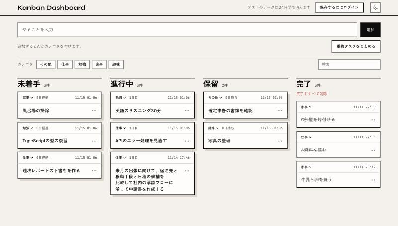
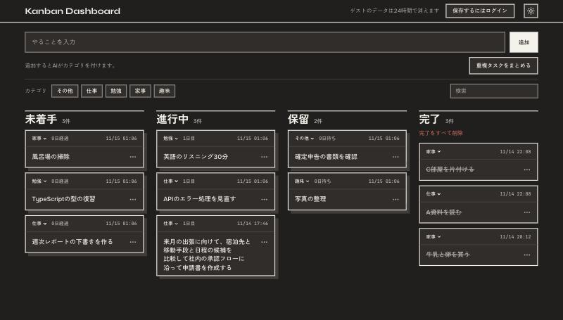

# Kanban Dashboard

AI がカテゴリを付け、重複タスクも探してくれる、Next.js 製のかんばんボードです。

**[デプロイ済みアプリを試す](https://nextjs-app-ta5aoszrnq-an.a.run.app)** — アクセスするとゲストセッションが始まり、登録なしですぐ試せます（Googleログインにも対応）。




## 作った背景

自分の ToDo はこれまで GitHub のリポジトリで管理していました。タスクの追加・カテゴリ分け・重複の統合は AI エージェントに頼んでいました。

リポジトリやエージェントがなくても同じことができるようにしたのが、このアプリです。

## 機能

- 「未着手 / 進行中 / 保留 / 完了」の 4 列ボード。ドラッグ、または「⋯」メニューで移動・編集・並べ替え・削除
- 削除の「元に戻す」（6秒間）、完了の一括削除、タイトル検索、ライト / ダーク切り替え
- **Gemini によるカテゴリの自動推定**（手動で変更も可）と、カテゴリでの絞り込み
- **Gemini による重複タスクの検出と統合提案**（押したときだけ実行し、統合は必ず1件ずつ確認）
- 3日以上動いていないタスクの停滞表示
- Google OAuth / ゲストログイン、ユーザーごとのタスク保存（APIはログイン必須で、他ユーザーのタスクには触れません）

## 技術スタック

Next.js 16 / React 19 / TypeScript / Tailwind CSS 4 / Auth.js / Prisma / PostgreSQL / Gemini API / Vitest / Docker / Google Cloud Run / Terraform / GitHub Actions

## 設計判断

### 構成
- 看板の定番どおり、4つの列を同じ幅で並べました（狭い画面では2列、さらに狭いと縦積み）。横スクロールは、画面外の列へドラッグできないため採りませんでした。
- バックエンドは Next.js の API Routes に同居させています。この規模では分離するほどの利点がなく、デプロイも1つで済むためです。
- ゲストは、`/` を開くと使い捨てのアカウントが自動で作られ、24時間で消えます（Cloud Scheduler が毎日、期限切れを削除）。Googleでログインするときは、先にゲストのセッションを破棄します。残したままだと、GoogleアカウントがゲストのユーザーIDに紐付いてしまい、以後そのGoogleアカウントでログインできなくなるためです。
- Gemini の無料枠は、2段で守っています。ゲスト1人あたりのAI利用は20回までで、DBの更新を1回の条件付き更新にして、並行リクエストでも上限を超えないようにしました。加えて、ユーザーに関係なくモデルごとに1日450回までというアプリ全体の上限を持ちます（この集計はインスタンスごとのメモリ上にあるため、Cloud Runが複数に増えると、インスタンスごとの上限になります）。分類と重複検出で別のモデルを使うのも、無料枠を別々に数えるためです。

### AIとの協働
AIコーディングツールを使って実装し、何を作るかの判断は自分で行いました。AIが書いたコードは、CIで、実DBでの結合テスト（他ユーザーのデータへの越権、ゲストのAI利用回数の上限、ページネーション）、ユニット・コンポーネントテスト、ESLint・ビルド・Dockerビルドを自動で実行して確かめます。

### トレードオフ
- **削除**: 確認ダイアログではなく「元に戻す」にしました。画面から先に消し、サーバーへの削除は6秒後に送ります。猶予中にブラウザが強制終了すると、削除は反映されません。
- **重複検出**: 追加のたびにAIへ問い合わせると回数と待ち時間が増えるため、AIの検出は押したときだけにしました。追加時は同じタイトルの通知だけを出します。
- **並べ替え**: 並び順は `Task.position`（整数、空欄可）です。並べ替えたら列の全カードに `0,1,2…` を振り直し、番号が変わったものだけ保存します。小数で中間値を挟む方式は、繰り返すと桁が足りなくなるため採りませんでした。
- **デプロイ**: デプロイはマイグレーションを実行しません。DBの変更を伴うときは、新しいコードを出す前に `npx prisma migrate deploy` を手で当てます。

## 開発

```bash
npm install
cp .env.example .env.local   # 値を埋める
npx prisma generate
npx prisma migrate deploy
npm run dev                  # http://localhost:3000
```

Google OAuth のコールバックURLに `http://localhost:3000/api/auth/callback/google` と、本番URLの同じパスを登録してください。

Docker で動かす場合は `docker compose up --build -d` です（AI分類には `GEMINI_API_KEY` をコンテナへ渡します）。

## デプロイ

main への push で、GitHub Actions がテストを走らせ、Cloud Run へデプロイします（Workload Identity で長期鍵なし）。インフラは `terraform/` にあります。
